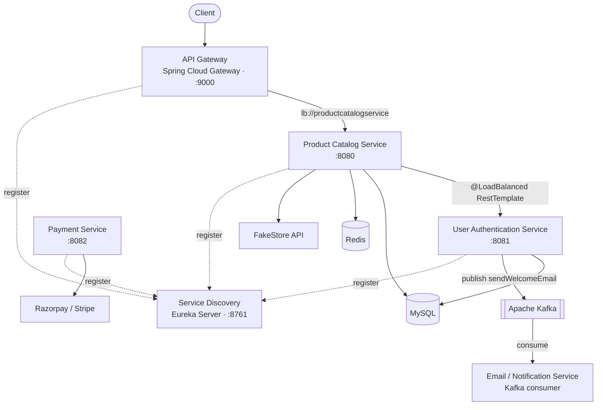

# ProjectBatchJune2025

# E-Commerce Backend System Microservices

A microservices-based backend for an online store, built with **Java 17** and the **Spring Boot / Spring Cloud** ecosystem. The platform is split into independent, separately deployable services for product catalog, user authentication, payments, notifications, service discovery and an API gateway communicating over REST and, where it helps, asynchronously over **Apache Kafka**.

This repository is the monorepo for the Capstone Project (Scaler Neovarsity / Woolf).

---

## Table of Contents
- [Architecture](#architecture)
- [Services](#services)
- [Tech Stack](#tech-stack)
- [Prerequisites](#prerequisites)
- [Getting Started (Local)](#getting-started-local)
- [Running Product Catalog with Docker](#running-product-catalog-with-docker)
- [Running Product Catalog on Kubernetes](#running-product-catalog-on-kubernetes)
- [API Reference](#api-reference)
- [Configuration & Secrets](#configuration--secrets)
- [Project Structure](#project-structure)
- [Testing](#testing)

---

## Architecture

Clients reach the system through a single **API Gateway**. All services register with a **Eureka** service registry, so they can be discovered and load-balanced by logical name. The Product Catalog and User Authentication services own their own MySQL databases; Product Catalog additionally uses Redis as a cache. User sign-up publishes an event to Kafka, which the Email service consumes to send a welcome email.



---

## Services

| Service | Folder | Default Port | Responsibility | Key tech |
|---|---|---|---|---|
| **Service Discovery** | `ServiceDiscoveryJune2025` | `8761` | Eureka registry; services register and are discovered by name | Spring Cloud Netflix Eureka Server |
| **API Gateway** | `APIGatewayJune2025` | `9000` | Single entry point; routes `/products/**` to the product service and load-balances | Spring Cloud Gateway, Eureka client |
| **Product Catalog** | `ProductCatalogService_June2025` | `8080` | Products & categories; FakeStore integration; paging/sorting/search | Spring MVC, JPA/Hibernate, MySQL, Redis, Eureka, Docker, K8s |
| **User Authentication** | `UserAuthService_June2025` | `8081` | Sign-up, login, JWT issue/validate; publishes welcome-email events | Spring Security, BCrypt, JJWT, MySQL, Kafka producer |
| **Payment** | `PaymentServiceJune2025` | `8082` | Creates hosted payment links; receives payment webhooks | Razorpay + Stripe (strategy pattern), Eureka |
| **Email / Notification** | `EmailServiceJune2025` | `8082` | Consumes Kafka events and sends emails over SMTP | Spring Kafka consumer, JavaMail |

> The services default to `localhost` for their dependencies and can be overridden with environment variables (see [Configuration & Secrets](#configuration--secrets)). The Payment and Email services both default to port `8082`; run them on different ports (`PORT` env var) if you start both at once.

---

## Tech Stack

- **Language / Framework:** Java 17, Spring Boot 4.1.x, Spring Cloud 2025.1.x
- **Web / APIs:** Spring MVC (REST), Spring Cloud Gateway (WebFlux)
- **Data:** Spring Data JPA + Hibernate, MySQL 8, Redis 7 (cache)
- **Security:** Spring Security, BCrypt, JSON Web Tokens (JJWT 0.12.5)
- **Service discovery & LB:** Spring Cloud Netflix Eureka, Spring Cloud LoadBalancer (`lb://`, `@LoadBalanced`)
- **Messaging:** Apache Kafka (Spring for Apache Kafka)
- **Payments:** Razorpay Java SDK 1.4.8, Stripe Java SDK 29.4.0
- **Email:** JavaMail (`javax.mail`) over SMTP
- **Build / tooling:** Maven (wrapper included), Lombok, Spring Boot DevTools
- **Testing:** JUnit 5, Mockito, Spring MockMvc (`@WebMvcTest`, `@SpringBootTest`)
- **Containers / orchestration:** Docker, Docker Compose, Kubernetes
- **Cloud:** AWS Elastic Beanstalk + RDS (Product Catalog)

---

## Prerequisites

- **JDK 17**
- **Maven** (or use the bundled `./mvnw` wrapper in each service)
- **MySQL 8** (for Product Catalog and User Auth)
- **Redis 7** (for Product Catalog caching)
- **Apache Kafka** (broker on `localhost:9092`, for User Auth → Email)
- *(Optional)* **Docker Desktop** to run the Product Catalog stack in containers or on Kubernetes

---

## Getting Started (Local)

Each service is a standalone Spring Boot app. Start the infrastructure first, then the registry, then the services.

**1. Start the infrastructure**

- MySQL on `localhost:3306` and create the two databases:
  ```sql
  CREATE DATABASE productcatalogservice_june2025;
  CREATE DATABASE userauthservice_june2025;
  ```
- Redis on `localhost:6379`
- Kafka broker on `localhost:9092`

**2. Start the Service Discovery (Eureka) server** must be up before the others:
```bash
cd ServiceDiscoveryJune2025
./mvnw spring-boot:run
```
Eureka dashboard: http://localhost:8761

**3. Start the business services** (each in its own terminal):
```bash
cd ProductCatalogService_June2025 && ./mvnw spring-boot:run   # :8080
cd UserAuthService_June2025        && ./mvnw spring-boot:run   # :8081
cd PaymentServiceJune2025          && ./mvnw spring-boot:run   # :8082
cd EmailServiceJune2025            && ./mvnw spring-boot:run   # Kafka consumer
```

**4. Start the API Gateway** (last):
```bash
cd APIGatewayJune2025
./mvnw spring-boot:run   # :9000
```

**5. Try it out** through the gateway:
```bash
curl http://localhost:9000/products/1
```

> To build a deployable JAR for any service: `./mvnw clean package` (the JAR lands in that service's `target/` folder).

---

## Running Product Catalog with Docker

The Product Catalog Service ships with a `Dockerfile` and a `docker-compose.yml` that brings up the app together with MySQL and Redis no local Java, MySQL or Redis required. (Eureka is disabled in this standalone setup.)

```bash
cd ProductCatalogService_June2025
cp .env.example .env            # then set DB_PASSWORD in .env
docker compose up --build       # first run / after a code change
```
The app is then available at http://localhost:8080/products.
See `ProductCatalogService_June2025/RUN_WITH_DOCKER.md` for the full guide.

---

## Running Product Catalog on Kubernetes

A Kubernetes manifest (`ProductServiceDeployment.yaml`) deploys the app, MySQL and Redis as Deployments + Services, with a PersistentVolumeClaim for the database and a Secret for the DB password. It targets the single-node cluster bundled with Docker Desktop.

```bash
cd ProductCatalogService_June2025
# 1. create the secret from your .env file
kubectl create secret generic productcatalog-secret --from-env-file=.env
# 2. apply the manifest
kubectl apply -f ProductServiceDeployment.yaml
```
The service is exposed as a `LoadBalancer` and reachable at http://localhost:8080/products.

---

## API Reference

All paths below are the service's own paths. Requests for `/products/**` can also go through the gateway at `http://localhost:9000`.

### Product Catalog Service (`:8080`)
| Method | Path | Description |
|---|---|---|
| GET | `/products` | List all products |
| GET | `/products/{id}` | Get a product by id (served from Redis cache when warm) |
| POST | `/products` | Create a product |
| PUT | `/products/{id}` | Replace a product |
| POST | `/search` | Search with paging and sorting |

### User Authentication Service (`:8081`)
| Method | Path | Description |
|---|---|---|
| POST | `/auth/signup` | Register a user (publishes a `sendWelcomeEmail` Kafka event) |
| POST | `/auth/login` | Authenticate and receive a JWT |
| POST | `/auth/validateToken` | Validate a token for a user |
| GET | `/auth/sample` | Demo endpoint used for inter-service calls |

### Payment Service (`:8082`)
| Method | Path | Description |
|---|---|---|
| POST | `/payment` | Create a hosted payment link (Stripe by default, Razorpay available) |
| POST | `/stripeWebhook` | Receive asynchronous Stripe payment events |

### Email / Notification Service
No REST API. Listens on the Kafka topic **`sendWelcomeEmail`** (group `emailServiceGroup`) and sends a welcome email over SMTP.

### Service Discovery & Gateway
- Eureka dashboard: `http://localhost:8761`
- Gateway: `http://localhost:9000` (routes `/products/**` → `productcatalogservice`)

---

## Configuration & Secrets

Services read their dependency hosts and credentials from configuration, with sensible `localhost` defaults. Prefer environment variables so that **no secret is committed to the repository**:

| Variable | Used by | Purpose |
|---|---|---|
| `MYSQL_HOST` | Product Catalog, User Auth | MySQL host (default `localhost`) |
| `REDIS_HOST` | Product Catalog | Redis host (default `localhost`) |
| `KAFKA_HOST` | User Auth | Kafka broker host (default `localhost`) |
| `DB_PASSWORD` / `SPRING_DATASOURCE_PASSWORD` | Product Catalog (Docker/K8s), MySQL | Database password |
| `RAZORPAY_ID`, `RAZORPAY_SECRET` | Payment | Razorpay API credentials |
| `STRIPE_KEY` | Payment | Stripe secret key |
| `EUREKA_CLIENT_ENABLED` | Product Catalog | Set `false` to run standalone (Docker/K8s) |

> **Security note:** some `application.properties` files and the Email service currently contain credentials inline (database password and an SMTP app password). Before pushing publicly, move these to environment variables (as the payment keys already are) and rotate any that have been exposed.

---

## Project Structure

```
ProjectBatchJune2025-Monorepo/
├── ServiceDiscoveryJune2025/      # Eureka service registry (:8761)
├── APIGatewayJune2025/            # Spring Cloud Gateway (:9000)
├── ProductCatalogService_June2025/# Products & categories (:8080) + Docker & K8s
│   ├── Dockerfile
│   ├── docker-compose.yml
│   ├── ProductServiceDeployment.yaml
│   └── RUN_WITH_DOCKER.md
├── UserAuthService_June2025/      # Auth, JWT, Kafka producer (:8081)
├── PaymentServiceJune2025/        # Razorpay + Stripe (:8082)
├── EmailServiceJune2025/          # Kafka consumer → SMTP email
└── README.md
```
Each service follows the standard Maven layout: `src/main/java`, `src/main/resources`, `src/test/java`, with its own `pom.xml` and Maven wrapper (`mvnw`).

---

## Testing

Run a service's tests with the Maven wrapper:
```bash
cd ProductCatalogService_June2025
./mvnw test
```
The Product Catalog Service includes controller tests using JUnit 5, Mockito and Spring MockMvc a `@WebMvcTest` slice test (`ProductControllerMvcTest`) and a `@SpringBootTest` integration test (`ProductControllerTest`) with the service and `RestTemplate` mocked so the tests run without the other services.

---

*Built incrementally as part of the Capstone Project module, with periodic commits over the course of the project.*
